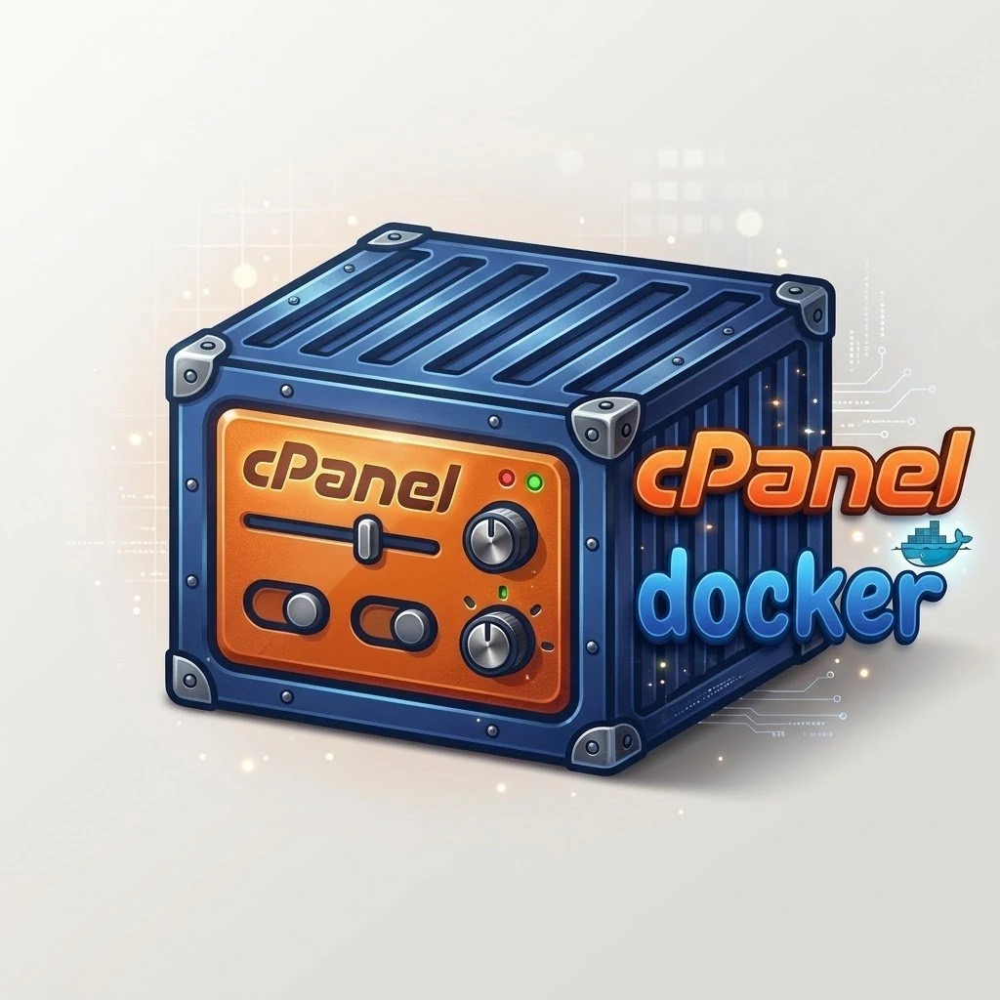

# Entorno de Desarrollo cPanel (AlmaLinux 8 en Docker)

🇺🇸 [English](README.md) | 🇧🇷 [Português (BR)](README-ptbr.md) | 🇪🇸 **Español**

[](LICENSE) [](https://github.com/sr00t3d/docker-cpanel/releases) [](docker-compose.yaml) [](docker-compose.yaml)



Este repositorio proporciona una infraestructura reproducible para ejecutar una instancia completa de **cPanel & WHM** dentro de un contenedor Docker usando **AlmaLinux 8**.

La arquitectura fue diseñada específicamente para **desarrollo de plugins y pruebas de integración**, resolviendo problemas habituales de arranque con `systemd`, bloqueos de archivos de log en drivers de almacenamiento (`overlay2`), sincronización de NAT/licencia y persistencia de datos.

## Características Principales

- **Aislamiento y Persistencia:** utiliza volúmenes nombrados de Docker (`cpanel_home`, `cpanel_etc`, `cpanel_var`, `cpanel_usr`, `cpanel_logs`, `cpanel_opt`) para conservar la instalación y la configuración al recrear el contenedor.
- **Listo para systemd:** se ejecuta con `privileged: true`, señal de apagado `SIGRTMIN+3`, montaje de cgroups y capabilities explícitas (`NET_ADMIN`, `SYS_ADMIN`, `SYS_RAWIO`).
- **Entrypoint Unificado (`docker/entrypoint.sh`):** genera `/etc/fstab` dinámicamente, inyecta dependencias básicas (`wget`, `perl`, `network-scripts`), protege el acceso root/SSH (`SSH_ROOT_LOGIN=no` por defecto) y gestiona la sincronización de NAT/licencia.
- **Healthcheck Integrado:** verifica automáticamente la disponibilidad HTTPS de WHM (`:2087`) y cPanel (`:2083`).
- **Edición en Tiempo Real del Core:** el volumen nombrado `cpanel_usr` monta `/usr/local/cpanel`, permitiendo enlaces simbólicos en el Host para editar plugins en tiempo real con VS Code sin `docker cp`.

## Configuración Inicial

Copia `.env.example` a `.env` y personaliza el hostname, puertos, límites de recursos y una contraseña `ROOT_PASSWORD` segura:

```bash
cp .env.example .env
```

```env
# --- Identification ---
CONTAINER_NAME=cpanel-server
HOSTNAME=srv.example.com
ROOT_PASSWORD=CambiaEstaContrasenaSegura!

# --- Networks and Access ---
SSH_PORT_HOST=22028
SSH_PORT_CONTAINER=22
SSH_ROOT_LOGIN=no
CPANEL_SSL_PORT=2083
CPANEL_NON_SSL_PORT=2082
WHM_SSL_PORT=2087
WHM_NON_SSL_PORT=2086
HTTP_PORT_HOST=8091
HTTPS_PORT_HOST=8447
HTTP_PORT_CONTAINER=80
HTTPS_PORT_CONTAINER=443

# --- Resources (Recomendado para cPanel) ---
CPU_LIMIT=2.0
MEM_LIMIT=4G
MEM_RESERVATION=2G

# --- System ---
TIMEZONE=America/Sao_Paulo
LANG=C.utf8
```

## Cómo Iniciar

```bash
# Validar la configuración de Compose
docker compose config --quiet

# Iniciar el contenedor en segundo plano
docker compose up -d

# Verificar estado y healthcheck
docker compose ps
```

### Reinstalación Manual Opcional de cPanel

```bash
docker exec -it cpanel-server bash -c "cd /home && curl -o latest -L https://securedownloads.cpanel.net/latest && sh latest"
```

*Nota: la instalación inicial de cPanel suele tardar entre 15 y 45 minutos según los recursos de CPU, RAM y red.*

## Flujo de Desarrollo (Edición en Tiempo Real)

Dado que `docker-compose.yaml` almacena `/usr/local/cpanel` en el volumen nombrado `cpanel_usr`, puedes crear un enlace simbólico en el Host para edición continua:

```bash
mkdir -p /home/cpanel/dev
ln -s /var/lib/docker/volumes/<directorio_proyecto>_cpanel_usr/_data /home/cpanel/dev/core
```

## Avisos de Seguridad

- **Solo Laboratorio / Desarrollo:** este contenedor se ejecuta con `privileged: true` por compatibilidad con `systemd`. No lo expongas en producción; cPanel en Docker no cuenta con soporte oficial de cPanel Inc. y requiere licencia válida.
- **Rotación de Credenciales:** cambia `ROOT_PASSWORD` inmediatamente tras el primer acceso a WHM (`https://<host>:2087`).

## Tutorial Detallado

Consulta la guía paso a paso completa: [Installing cPanel in Docker](https://perciocastelo.com.br/blog/installing-cpanel-in-docker.html)

## Licencia

Licenciado bajo la [Apache License 2.0](LICENSE).
