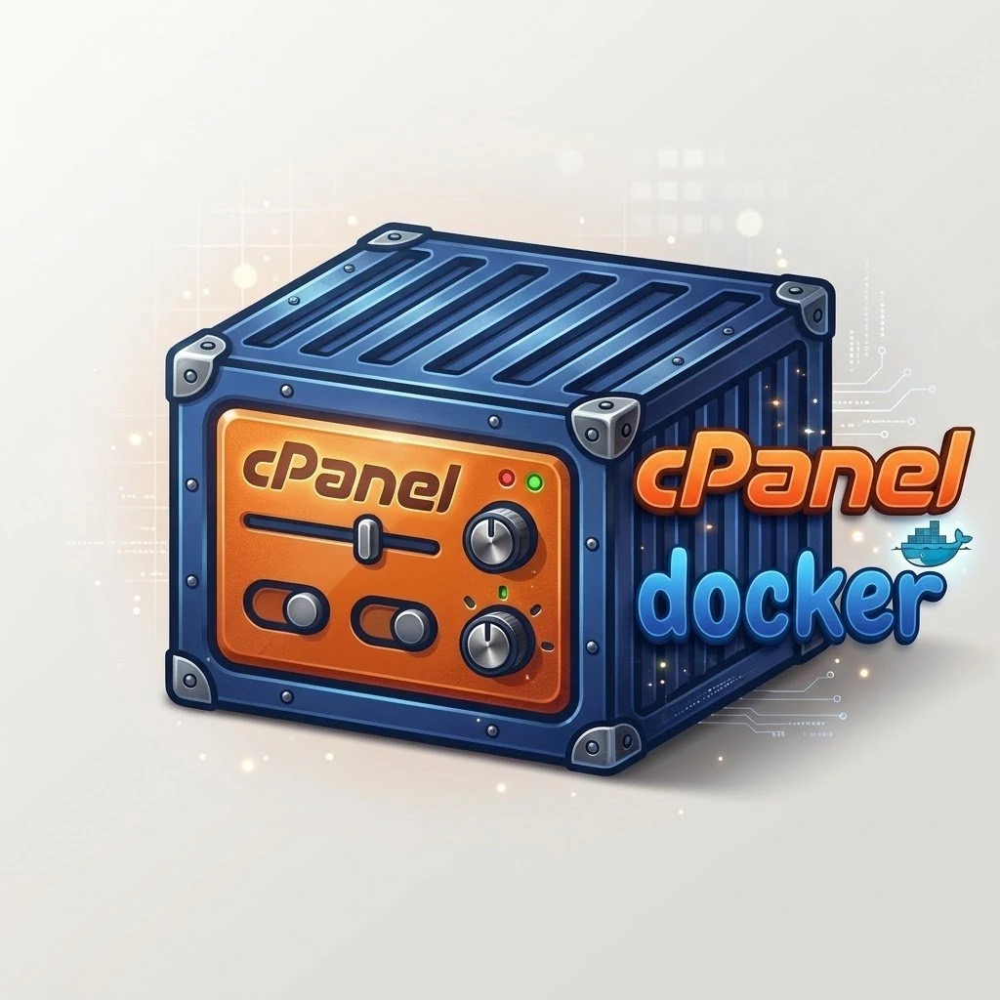

# cPanel Dev Environment (AlmaLinux 8 on Docker)

🇺🇸 **English** | 🇧🇷 [Português (BR)](README-ptbr.md) | 🇪🇸 [Español](README-es.md)

[](LICENSE) [](https://github.com/sr00t3d/docker-cpanel/releases) [](docker-compose.yaml) [](docker-compose.yaml)



This repository provides a reproducible infrastructure to run a full **cPanel & WHM** instance inside a Docker container using **AlmaLinux 8**.

The architecture is designed specifically for **plugin development and integration testing**, solving common container boot issues with `systemd`, log file locks caused by storage drivers (`overlay2`), NAT/license synchronization, and data persistence.

## Main Features

- **Isolation and Persistence:** uses Docker named volumes (`cpanel_home`, `cpanel_etc`, `cpanel_var`, `cpanel_usr`, `cpanel_logs`, `cpanel_opt`) so configuration and installation state survive container recreation.
- **systemd Ready:** runs with `privileged: true`, `SIGRTMIN+3` graceful stop signal, cgroup mount, and explicit Linux capabilities (`NET_ADMIN`, `SYS_ADMIN`, `SYS_RAWIO`).
- **Unified Entrypoint (`docker/entrypoint.sh`):** dynamically prepares `/etc/fstab`, injects base dependencies (`wget`, `perl`, `network-scripts`), secures root/SSH settings (`SSH_ROOT_LOGIN=no` by default), and handles NAT/license sync.
- **Built-in Healthcheck:** monitors WHM (`:2087`) and cPanel (`:2083`) HTTPS availability automatically.
- **Real-Time Core Editing:** the `cpanel_usr` named volume maps `/usr/local/cpanel`, allowing host-side symlinks for instant plugin development in VS Code without `docker cp`.

## Initial Configuration

Copy `.env.example` to `.env` and customize your hostname, ports, resource limits, and strong `ROOT_PASSWORD`:

```bash
cp .env.example .env
```

```env
# --- Identification ---
CONTAINER_NAME=cpanel-server
HOSTNAME=srv.example.com
ROOT_PASSWORD=ChangeThisStrongPassword!

# --- Networks and Access ---
SSH_PORT_HOST=22028
SSH_PORT_CONTAINER=22
SSH_ROOT_LOGIN=no
CPANEL_SSL_PORT=2083
CPANEL_NON_SSL_PORT=2082
WHM_SSL_PORT=2087
WHM_NON_SSL_PORT=2086
HTTP_PORT_HOST=8091
HTTPS_PORT_HOST=8447
HTTP_PORT_CONTAINER=80
HTTPS_PORT_CONTAINER=443

# --- Resources (Recommended for cPanel) ---
CPU_LIMIT=2.0
MEM_LIMIT=4G
MEM_RESERVATION=2G

# --- System ---
TIMEZONE=America/Sao_Paulo
LANG=C.utf8
```

## How to Start

```bash
# Validate compose configuration
docker compose config --quiet

# Start container in background
docker compose up -d

# Check container status & healthcheck
docker compose ps
```

### Optional Manual Reinstall of cPanel

```bash
docker exec -it cpanel-server bash -c "cd /home && curl -o latest -L https://securedownloads.cpanel.net/latest && sh latest"
```

*Note: Initial cPanel installation typically takes 15 to 45 minutes depending on CPU, RAM, and network speed.*

## Development Workflow (Real-Time Editing)

Because `docker-compose.yaml` stores `/usr/local/cpanel` in the `cpanel_usr` named volume, you can symlink it on the host for live IDE editing:

```bash
mkdir -p /home/cpanel/dev
ln -s /var/lib/docker/volumes/<project_dir>_cpanel_usr/_data /home/cpanel/dev/core
```

## Security Notice

- **Lab / Development Only:** this container runs with `privileged: true` for `systemd` compatibility. Do **not** expose it directly to production traffic; cPanel inside Docker is unsupported by cPanel Inc. and requires a valid license.
- **Rotate Credentials:** change `ROOT_PASSWORD` immediately on first WHM login (`https://<host>:2087`).

## Detailed Tutorial

Read the full step-by-step guide: [Installing cPanel in Docker](https://perciocastelo.com.br/blog/installing-cpanel-in-docker.html)

## License

Licensed under the [Apache License 2.0](LICENSE).
